<a id="inicio"></a>

# Administración de servidores GNU/Linux

## Clase 13: LVM y RAID

Módulo 1 — Operación de Sistemas Operativos GNU/Linux

---

<a id="index"></a>

### Temas de la clase 13

- [El problema](#el_problema)
- [LVM](#lvm)
- [Crear y ampliar](#crear_y_ampliar)
- [Instantáneas y LVM thin](#instantaneas_y_lvm_thin)
- [RAID](#raid)
- [Dónde se arma el RAID](#donde_se_arma_el_raid)
- [Seguridad](#seguridad)
- [Actividades prácticas y laboratorios](#labs)

[Exportar a PDF](../clase13.html?print-pdf)

---

<a id="objetivos_de_la_clase"></a>

### Objetivos de la clase

Al finalizar vas a poder:

- Explicar qué son un PV, un VG y un LV.
- Ampliar un volumen lógico y su sistema de archivos con el sistema en marcha.
- Explicar la diferencia entre un volumen clásico y uno thin.
- Comparar los niveles de RAID por capacidad y fallas que toleran.
- Tomar una instantánea de un volumen lógico y volver atrás con ella.

---

<a id="lo_que_ya_vimos"></a>

### Lo que ya vimos

- [Clase 2](../clase2.html#/thin_thick): discos virtuales thin y thick, el [sobreaprovisionamiento](../clase2.html#/overcommit) y que una [instantánea no es un respaldo](../clase2.html#/snapshot_no_backup).
- [Clase 3](../clase3.html#/filesystems): Btrfs y ZFS en la tabla de sistemas de archivos. El instalador ofrecía LVM y lo dejamos para hoy.
- [Clase 11](../clase11.html#/rocky_linux_9): la VM Rocky. Su instalador usó LVM.
- [Clase 12](../clase12.html#/ampliar_una_particion): ampliar una partición y su sistema de archivos.

> **Nota docente:** la práctica de hoy es en la VM Rocky, no en la Debian. Conviene avisar al principio para que la tengan importada.

---

<a id="el_problema"></a>

## El problema

Lo que no se puede hacer con particiones.

---

<a id="particiones_fijas"></a>

### Particiones fijas

- **Se llena `/`.** Solo se amplía si hay lugar libre justo detrás.
- **Se llena `/srv/datos` y compramos otro disco.** El disco nuevo es otro sistema de archivos, con otro punto de montaje.
- **Se rompe un disco.** Se pierde lo que tenía y el servicio se cae.

> **Nota docente:** en el Lab 11.1 la raíz creció porque la swap estaba detrás y la pudimos borrar. Si hubiera habido otra partición con datos, no se podía.

---

<a id="dos_capas_nuevas"></a>

### Dos capas nuevas

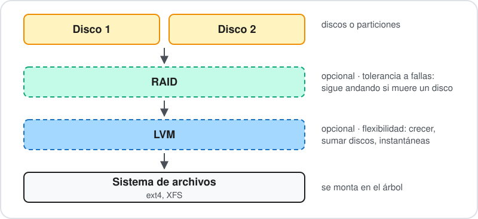

- **LVM** resuelve las dos primeras: crecer y sumar discos.
- **RAID** resuelve la tercera: seguir andando si muere un disco.

> **Nota docente:** son independientes. Se puede usar una, las dos o ninguna.

---

<a id="lvm"></a>

## LVM

\*Logical Volume Manager*

---

<a id="que_es_lvm"></a>

### ¿Qué es LVM?

Una capa entre los discos y el sistema de archivos que **junta el espacio** de uno o varios discos y lo **reparte en volúmenes**.

- Los volúmenes se agrandan, se achican o se mueven sin tocar la tabla de particiones.
- Para el sistema de archivos, un volumen es como una partición.

> **Nota docente:** la comparación de los bidones: los PV son bidones, el VG es el tanque donde se vuelca todo y los LV son las botellas que se llenan desde el tanque.

---

<a id="las_tres_capas"></a>

### Las tres capas

| Capa | Qué es | Se crea con |
| --- | --- | --- |
| **PV**, volumen físico | Un disco o una partición preparada para LVM | `pvcreate` |
| **VG**, grupo de volúmenes | El espacio de uno o varios PV junto | `vgcreate` |
| **LV**, volumen lógico | Un tramo del VG que se formatea y se monta | `lvcreate` |

---

<a id="paso_1_discos_y_particiones"></a>

### Paso 1: discos y particiones

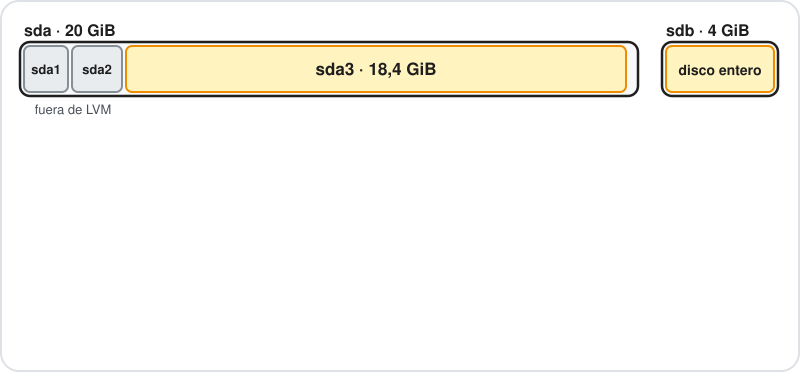

- `sda1` y `sda2` quedan fuera de LVM.
- `sda3` y `sdb` entero van a LVM.

\*Para explicar mejor el concepto de LVM se agrega en la imágen un disco de 4GiB que es como se hará el Lab 12.1.

> **Nota docente:** es la VM Rocky como queda al terminar el Lab 12.1. `sdb` es el disco de 4 GiB que se agrega en el laboratorio.

---

<a id="paso_2_volumenes_fisicos"></a>

### Paso 2: volúmenes físicos

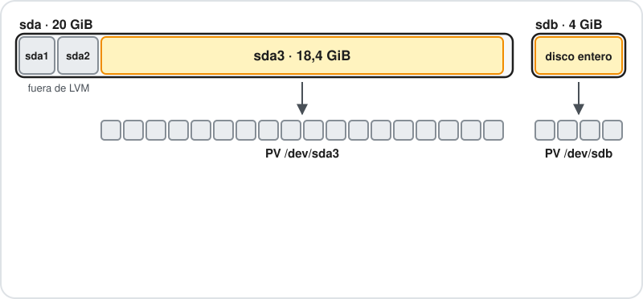

- `pvcreate` prepara cada uno para LVM.
- El PV se divide en **extensiones** del mismo tamaño (4 MiB por defecto).

> **Nota docente:** cada cuadrado del dibujo es 1 GiB, redondeado. En cada uno entran unas 256 extensiones reales.

---

<a id="paso_3_grupo_de_volumenes"></a>

### Paso 3: grupo de volúmenes

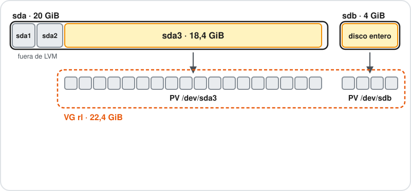

- `vgcreate` junta los PV en un VG. Para sumar un PV a un VG que ya existe: `vgextend`.
- Desde acá LVM no piensa en discos: tiene 22 cuadrados para repartir.

---

<a id="paso_4_volumenes_logicos"></a>

### Paso 4: volúmenes lógicos

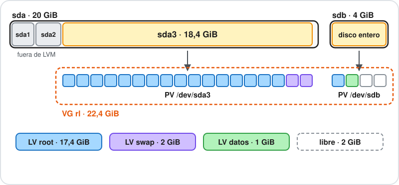

- `lvcreate` reparte extensiones del VG entre los LV.
- `root` tiene extensiones en los dos discos y para el sistema es **un solo volumen**.
- Lo libre queda para crecer.

---

<a id="paso_5_sistemas_de_archivos"></a>

### Paso 5: sistemas de archivos

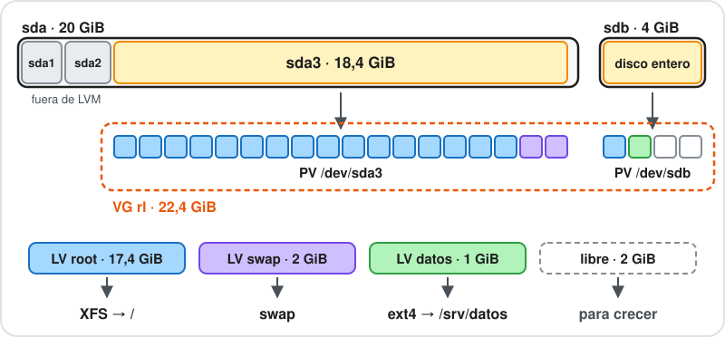

Cada LV se formatea y se monta como una partición. Desde acá, todo es lo de la [clase 12](../clase12.html#/etc_fstab).

---

<a id="como_se_llaman_los_volumenes"></a>

### Cómo se llaman los volúmenes

| Ruta | Qué es |
| --- | --- |
| `/dev/dm-0`, `/dev/dm-1` | El dispositivo que crea el kernel. El número puede cambiar. |
| `/dev/mapper/rl-root` | Nombre estable: VG y LV unidos por un guion. |
| `/dev/rl/root` | Otro nombre estable, un directorio por VG. |

Como el nombre no cambia, `fstab` puede usarlo sin UUID:

```text
/dev/mapper/rl-root     /      xfs     defaults        0 0
/dev/mapper/rl-swap     none   swap    defaults        0 0
```

> **Nota docente:** LVM usa el *device mapper* del kernel, la misma pieza que usa el cifrado de discos (LUKS, al final de la clase). Si el nombre tiene guion, en `/dev/mapper` se duplica: `mis-datos` aparece como `mis--datos`.

---

<a id="lvm_en_la_vm_rocky"></a>

### LVM en la VM Rocky

```text
$ lsblk -o NAME,SIZE,TYPE,FSTYPE,MOUNTPOINTS
NAME         SIZE TYPE FSTYPE      MOUNTPOINTS
sda           20G disk             
├─sda1       600M part vfat        /boot/efi
├─sda2         1G part xfs         /boot
└─sda3      18,4G part LVM2_member 
  ├─rl-root 16,4G lvm  xfs         /
  └─rl-swap    2G lvm  swap        [SWAP]
sr0         1024M rom              
```

- `sda3` es el PV (`LVM2_member`).
- El VG se llama `rl` y tiene dos LV: `root` y `swap`.
- `root` y `swap` ocupan todo el PV: no queda espacio libre.

> **Nota docente:** `/boot` queda fuera de LVM para que el arranque no dependa de él. Salida real, revisada el 2026-10-07.

---

<a id="pvs_vgs_y_lvs"></a>

### pvs, vgs y lvs

```text
$ sudo pvs
  PV         VG Fmt  Attr PSize  PFree
  /dev/sda3  rl lvm2 a--  18,41g    0 
$ sudo vgs
  VG #PV #LV #SN Attr   VSize  VFree
  rl   1   2   0 wz--n- 18,41g    0 
$ sudo lvs
  LV   VG Attr       LSize  Pool Origin Data%  Meta%  Move Log Cpy%Sync Convert
  root rl -wi-ao---- 16,41g
  swap rl -wi-ao----  2,00g
```

- `PFree` y `VFree` en 0: no hay lugar para crecer.
- Para ver el detalle: `pvdisplay`, `vgdisplay`, `lvdisplay`.

> **Nota docente:** salida real de la VM Rocky (2026-10-13). En `Attr` de `lvs`, la `a` es activo y la `o` abierto (montado o en uso como swap). `pvdisplay` confirma extensiones de 4 MiB, 4713 en total y ninguna libre. Con `lvs -o +devices` se ve que la swap ocupa el principio del PV y `root` empieza en la extensión 512.

---

<a id="consultas"></a>

### Consultas

- ¿Qué diferencia hay entre un PV y un VG?
- ¿Por qué `fstab` de Rocky puede usar `/dev/mapper/rl-root` sin UUID?
- En la VM Rocky, ¿cuánto espacio libre tiene el VG?

---

<a id="crear_y_ampliar"></a>

## Crear y ampliar

Lo que más se usa de LVM.

---

<a id="crear_un_volumen"></a>

### Crear un volumen

```bash
sudo pvcreate /dev/sdb
sudo vgcreate datos /dev/sdb
sudo lvcreate -n web -L 1G datos
sudo mkfs.xfs /dev/datos/web
sudo mount /dev/datos/web /srv/web
```

| Opción | Tamaño |
| --- | --- |
| `-L 1G` | 1 GiB exacto |
| `-l 100%FREE` | Todo lo libre del VG |
| `-l 50%FREE` | La mitad de lo libre |

> **Nota docente:** un LV recién creado está vacío, igual que una partición nueva. Conviene no asignar todo el VG de entrada: lo libre es lo que permite crecer después.

---

<a id="ampliar_en_caliente"></a>

### Ampliar en caliente

```bash
sudo lvextend -r -L +1G rl/root
```

- `-L +1G` suma 1 GiB. `-l +100%FREE` le da todo lo libre.
- `-r` agranda también el sistema de archivos.

Sin `-r`, el LV crece pero `df` muestra lo mismo. Hay que hacerlo a mano:

| Sistema de archivos | Comando |
| --- | --- |
| ext4 | `resize2fs /dev/rl/datos` |
| XFS | `xfs_growfs /` |

> **Nota docente:** es el mismo problema que en la [clase 12](../clase12.html#/ampliar_una_particion): crecer el contenedor no agranda el sistema de archivos. Olvidar `-r` es el error más común.

---

<a id="si_el_vg_esta_lleno"></a>

### Si el VG está lleno

Primero hay que darle espacio al VG:

- **Un disco nuevo:** `pvcreate /dev/sdb` y `vgextend rl /dev/sdb`.
- **Agrandar el disco existente:** agrandar `sda3` como en el Lab 11.1 y después `pvresize /dev/sda3`.

Después, `lvextend -r`.

---

<a id="ampliar_la_raiz_de_rocky"></a>

### Ampliar la raíz de Rocky

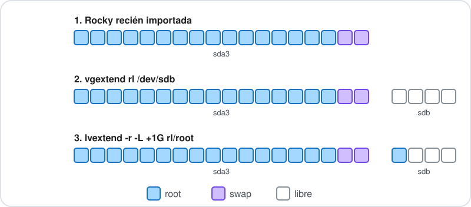

> **Nota docente:** es el Lab 12.1. Con particiones no se puede hacer que `/` ocupe dos discos; con LVM es un comando.

---

<a id="un_lv_en_dos_discos"></a>

### Un LV en dos discos

- Desde el `vgextend`, `root` tiene extensiones en `sda3` y en `sdb`.
- Si muere cualquiera de los dos, se pierde `root` entero.
- Sin RAID, LVM no protege los datos.

> **Nota docente:** frente a una falla, un VG en varios discos sin RAID es tan frágil como un RAID 0. Por eso el laboratorio empieza con una instantánea de VirtualBox.

---

<a id="achicar"></a>

### Achicar

- **ext4:** se puede, con el volumen desmontado. `lvreduce -r` achica primero el sistema de archivos y después el LV.
- **XFS:** no se puede achicar. Por eso conviene dejar espacio libre en el VG en lugar de asignarlo todo de entrada.

> **Nota docente:** la raíz de Rocky es XFS. `pvmove` mueve las extensiones de un disco a otro con el sistema en uso, y `vgreduce` saca el disco del VG: sirve para cambiar un disco sin apagar. Solo se menciona.

---

<a id="consultas_2"></a>

### Consultas

- Después de `lvextend` sin `-r`, ¿qué muestra `df`?
- ¿Qué dos caminos hay para darle espacio a un VG lleno?
- ¿Qué pasa con `root` si se rompe el disco que sumamos?

---

<a id="instantaneas_y_lvm_thin"></a>

## Instantáneas y LVM thin


---

<a id="instantanea_de_lvm"></a>

### Instantánea de LVM

Congela el estado de un LV en un momento. El original sigue en uso.

- Sirve para probar un cambio y volver atrás.
- Sirve para respaldar un sistema en uso: se copia desde la instantánea, que no cambia.
- Como la de VirtualBox, [no es un respaldo](../clase2.html#/snapshot_no_backup): está en los mismos discos.

> **Nota docente:** la de VirtualBox congela la VM entera desde afuera; la de LVM congela un volumen desde adentro del sistema. El uso para respaldos se retoma en la clase 24.

---

<a id="instantanea_clasica"></a>

### Instantánea clásica

```bash
sudo lvcreate -s -n datos-antes -L 200M rl/datos
```

- Al crearla no se copia nada.
- Antes de modificar un bloque del original, LVM guarda el bloque viejo en la instantánea.
- `-L 200M` es el lugar para esos bloques viejos. **Si se llena, se invalida.**

Para volver atrás:

```bash
sudo umount /srv/datos
sudo lvconvert --merge rl/datos-antes
sudo mount /srv/datos
```

> **Nota docente:** mientras exista, cada escritura cuesta dos. Se borra apenas cumplió su función. Si el LV no se puede desmontar, la fusión queda para el próximo arranque.

---

<a id="lvm_thin"></a>

### LVM thin

Lo mismo que vimos con los [discos virtuales thin](../clase2.html#/thin_thick), pero dentro de LVM.

- **Volumen clásico:** reserva todo su espacio al crearse.
- **Volumen thin:** ocupa lugar a medida que se escribe.

El **pool** es un LV que reserva espacio del VG. Los volúmenes thin se sirven de ahí, a medida que escriben.

- El pool no se formatea ni se monta.
- Los volúmenes thin sí, y se usan como cualquier LV.

---

<a id="pool_y_volumenes_thin"></a>

### Pool y volúmenes thin

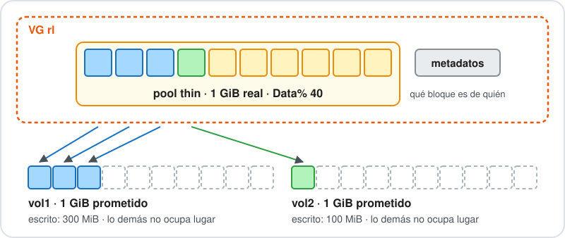

```bash
sudo lvcreate --type thin-pool -n pool -L 1G rl
sudo lvcreate --thin -n vol1 -V 1G rl/pool
sudo lvcreate --thin -n vol2 -V 1G rl/pool
```

> **Nota docente:** `-L` es el tamaño real del pool y `-V` el tamaño que ve el sistema de archivos. Los metadatos son otro LV oculto que anota qué bloque del pool es de cada volumen.

---

<a id="sobreasignacion"></a>

### Sobreasignación

En el ejemplo se prometieron 2 GiB sobre un pool de 1 GiB.

- Funciona mientras no se escriba todo junto.
- Si el pool se llena, los volúmenes no pueden escribir. Puede haber corrupción.
- Hay que vigilar `Data%` y `Meta%` en `lvs`.

```text
  LV   VG      Attr       LSize Pool Origin Data%  Meta%
  pool pruebas twi-aotz-- 1,00g             35,62  14,36
  vol1 pruebas Vwi-aotz-- 1,00g pool        35,62
  vol2 pruebas Vwi-a-tz-- 1,00g pool        0,00
```

> **Nota docente:** salida real en la VM Rocky (2026-10-13), en un VG de prueba `pruebas` armado sobre un archivo, con 300 MiB escritos en `vol1` (las columnas vacías del final se recortaron). Al crear `vol2`, LVM avisa: `WARNING: Sum of all thin volume sizes (2,00 GiB) exceeds the size of thin pool` y sugiere bajar `thin_pool_autoextend_threshold`. Después de borrar el archivo, `Data%` siguió en 35,62; con `fstrim` bajó a 6,30. Es el mismo riesgo del [sobreaprovisionamiento](../clase2.html#/overcommit) de la clase 2. `thin_pool_autoextend_threshold` en `/etc/lvm/lvm.conf` hace crecer el pool solo (por defecto está desactivado). Borrar archivos no devuelve espacio al pool sin `fstrim`.

---

<a id="instantanea_clasica_o_thin"></a>

### Instantánea clásica o thin

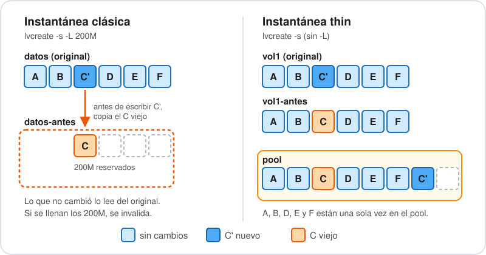

- La thin no lleva `-L`: comparte bloques con el original y ocupa solo lo que cambia.
- Se crea al instante y se pueden tener muchas.

> **Nota docente:** las instantáneas thin se crean inactivas. Para usarlas: `lvchange -ay -K`.

---

<a id="lvm_thin_en_proxmox"></a>

### LVM thin en Proxmox

| LV en el VG `pve` | En Proxmox |
| --- | --- |
| `root` | Almacenamiento `local`, para ISO y respaldos |
| `swap` | Swap |
| `data` | Pool thin: almacenamiento `local-lvm` |

- Cada disco de VM es un volumen thin dentro de `data`.
- Por eso las instantáneas de VM son rápidas.
- Y por eso hay que vigilar `Data%`.

---

<a id="consultas_3"></a>

### Consultas

- ¿Qué pasa si se llena el espacio de una instantánea clásica?
- ¿Qué indica el `-V` de un volumen thin?
- ¿Por qué una instantánea thin casi no ocupa lugar al crearla?

---

<a id="raid"></a>

## RAID

\*Redundant Array of Independent Disks*

---

<a id="que_es_raid"></a>

### ¿Qué es RAID?

Varios discos combinados en uno solo para ganar:

- velocidad,
- tolerancia a fallas,
- o las dos cosas.

Cada forma de combinarlos es un **nivel**.

---

<a id="raid_0_distribucion"></a>

### RAID 0: distribución

Mínimo 2 discos · Capacidad: la suma de todos · No tolera fallas

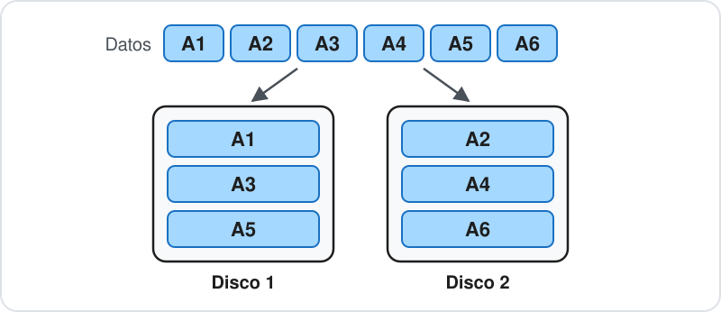

| Ventajas | Desventajas |
| --- | --- |
| Lee y escribe más rápido: usa los discos a la vez | Si muere un disco, se pierde todo |
| Aprovecha toda la capacidad | Cuantos más discos, más probable la falla |

> **Nota docente:** aunque se llame RAID, no tiene redundancia. Sirve para datos temporales que se pueden regenerar.

---

<a id="raid_1_espejo"></a>

### RAID 1: espejo

Mínimo 2 discos · Capacidad: la de un disco · Tolera la falla de todos menos uno

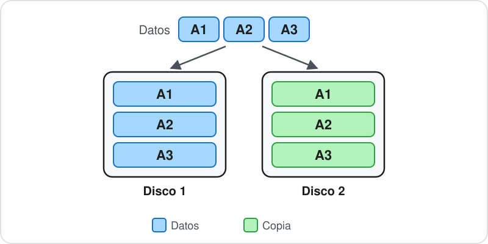

| Ventajas | Desventajas |
| --- | --- |
| Lee más rápido: puede leer de cualquier disco | Se pierde la mitad de la capacidad |
| Sigue andando con un solo disco | Escribe igual que un disco solo |
| Reconstruir es copiar el disco sano |  |

> **Nota docente:** es el de los discos de sistema en servidores.

---

<a id="raid_5_paridad_distribuida"></a>

### RAID 5: paridad distribuida

Mínimo 3 discos · Capacidad: todos menos uno · Tolera la falla de un disco

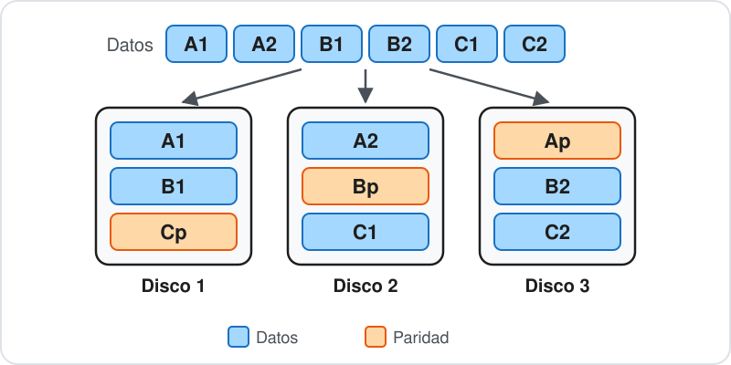

| Ventajas | Desventajas |
| --- | --- |
| Tolera una falla y pierde solo un disco de capacidad | Escribe más lento: recalcula la paridad |
| Lee rápido | Degradado, cada lectura del disco caído se calcula |
|  | Con discos grandes, la reconstrucción es larga y riesgosa |

> **Nota docente:** la **paridad** permite recalcular el bloque que falte. Si se pierde el disco 2, A2 se recalcula con A1 y Ap, y C1 con Cp y C2. Con un disco caído sigue andando, **degradado**.

---

<a id="raid_6_doble_paridad"></a>

### RAID 6: doble paridad

Mínimo 4 discos · Capacidad: todos menos dos · Tolera la falla de dos discos

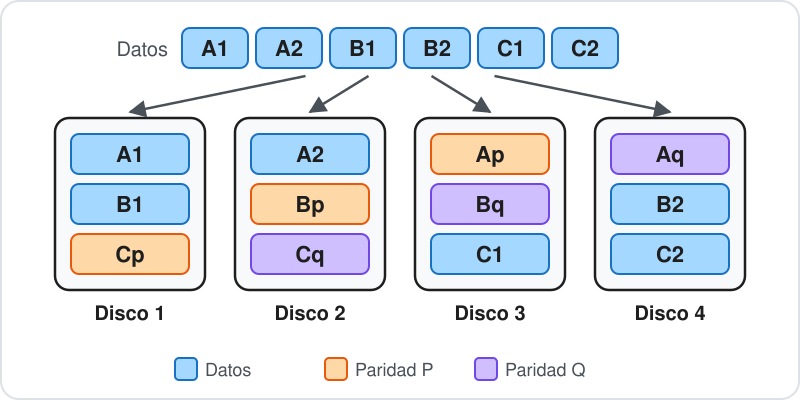

| Ventajas | Desventajas |
| --- | --- |
| Tolera dos fallas cualesquiera | Escribe más lento que RAID 5: calcula dos paridades |
| Aguanta otra falla durante la reconstrucción | Pierde dos discos de capacidad |

> **Nota docente:** es el RAID 5 pensado para discos grandes. P es XOR, como en RAID 5; Q usa otro cálculo, así que no es una copia de P.

---

<a id="raid_10_espejos_repartidos"></a>

### RAID 10: espejos repartidos

Mínimo 4 discos · Capacidad: la mitad · Tolera una falla seguro, una por espejo si hay suerte

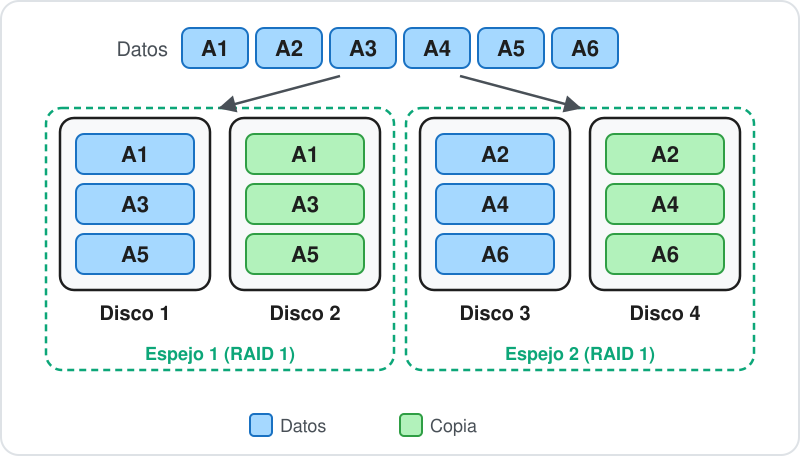

| Ventajas | Desventajas |
| --- | --- |
| Lee y escribe rápido: no hay paridad | Se pierde la mitad de la capacidad |
| Reconstruir es copiar el compañero de espejo | Si caen los dos discos de un espejo, se pierde todo |

> **Nota docente:** pares en espejo (RAID 1) y los datos repartidos entre los pares (RAID 0). Se usa para bases de datos y discos de VM.

---

<a id="comparacion"></a>

### Comparación

Ejemplos con 4 discos de 1 TB · ×1 = velocidad de un disco

| Nivel | Mínimo | Capacidad | Fallas que tolera | Lectura | Escritura |
| --- | --- | --- | --- | --- | --- |
| RAID 0 (*stripe*) | 2 | 4 TB | Ninguna | ×4 | ×4 |
| RAID 1 (*mirror*) | 2 | 1 TB | 3 | ×4 | ×1 |
| RAID 5 (*parity*) | 3 | 3 TB | 1 | ×3 | ×1 |
| RAID 6 (*double parity*) | 4 | 2 TB | 2 | ×2 | ×1 |
| RAID 10 (*mirror + stripe*) | 4 | 2 TB | 1 seguro | ×4 | ×2 |

> **Nota docente:** son ganancias teóricas, con el mismo criterio que [raid-calculator.com](https://www.raid-calculator.com). En RAID 5 y RAID 6 la escritura no gana: cambiar un bloque obliga a leer y reescribir la paridad (4 operaciones en RAID 5, 6 en RAID 6). Con escrituras grandes y seguidas pueden andar algo mejor, pero con escrituras chicas al azar quedan incluso por debajo de un disco solo; por eso las bases de datos prefieren RAID 10. RAID 1 escribe como un disco porque cada dato va a todos. RAID 1 con cuatro discos son cuatro copias; la calculadora avisa que espera exactamente dos discos en RAID 1, pero MD permite más. Valores comprobados en la calculadora el 2026-10-13 con 4 discos de 1 TB. RAID 10 tolera 2 fallas si caen en espejos distintos.

---

<a id="la_reconstruccion"></a>

### La reconstrucción

Al cambiar el disco roto, el arreglo copia o recalcula todo en el nuevo.

- Los discos que quedan trabajan a fondo durante horas.
- Suelen ser del mismo lote y la misma edad que el que murió.
- En RAID 5, un error de lectura durante la reconstrucción no se puede recuperar.

Con discos grandes se prefiere RAID 6 o RAID 10.

---

<a id="disco_de_reserva_spare"></a>

### Disco de reserva (*spare*)

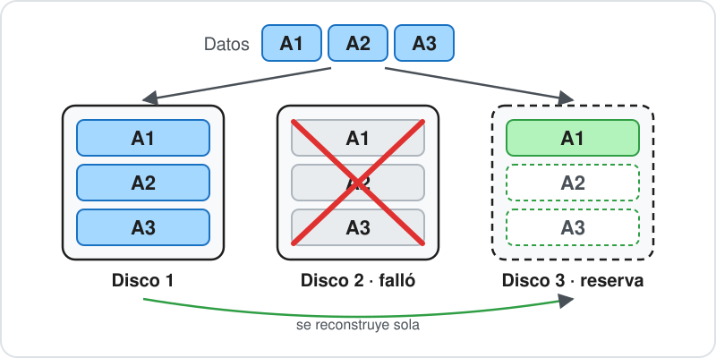

- Un disco conectado al arreglo que no guarda nada mientras todo anda bien.
- Cuando falla un disco, la reconstrucción empieza sola sobre la reserva, sin esperar a que alguien lo cambie.
- Se usa en servidores lejos o sin nadie que cambie un disco enseguida, y en arreglos grandes, para acortar el tiempo degradado.

> **Nota docente:** el disco roto hay que cambiarlo igual; el nuevo pasa a ser la próxima reserva. En `mdadm`, un disco que se agrega a un arreglo completo queda como reserva y se ve con `(S)` en `/proc/mdstat`. Con cuatro discos, muchos prefieren RAID 6 antes que RAID 5 más una reserva: el disco extra ya protege desde el primer momento, sin esperar una reconstrucción.

---

<a id="raid_no_es_un_respaldo"></a>

### RAID no es un respaldo

RAID protege contra una cosa: que un disco se rompa.

- Un `rm` equivocado se borra en todos los discos.
- Un ransomware cifra todos los discos.
- Un archivo dañado por un programa queda dañado en todos.

RAID mantiene el servicio andando. Los datos los recupera el respaldo.

---

<a id="consultas_4"></a>

### Consultas

- Con tres discos de 1 TB en RAID 5, ¿cuánto espacio útil queda?
- ¿Cuántos discos pueden fallar en un RAID 1 de dos discos?
- ¿Qué gana RAID 6 frente a RAID 5, y qué pierde?
- ¿Por qué la reconstrucción es el momento de más riesgo?

---

<a id="donde_se_arma_el_raid"></a>

## Dónde se arma el RAID

Software, hardware o el sistema de archivos.

---

<a id="raid_por_software_en_linux"></a>

### RAID por software en Linux

- Linux arma RAID sin hardware especial: lo hace el propio kernel.
- Hoy es muy eficiente: con los discos y procesadores actuales casi no se nota.
- El arreglo no depende de una placa: los discos se pueden llevar a otro equipo.
- Los instaladores de Debian y Rocky lo ofrecen.

> **Nota docente:** la pieza del kernel se llama MD y el programa para administrarlo, `mdadm`. No se practica; los comandos están en la sección 8 del apunte.

---

<a id="controladoras_por_hardware"></a>

### Controladoras por hardware

Una placa con su procesador arma el arreglo. El sistema ve **un solo disco**.

- Se configuran desde su firmware, como vimos en la [clase 3](../clase3.html#/servidor_fisico), o con programas del fabricante.
- Si se rompe la controladora, para leer los discos hace falta otra compatible.

> **Nota docente:** el RAID «de la placa madre» (*fake RAID*, como Intel RST) lo configura el firmware, pero el trabajo lo hace el sistema operativo; en Linux lo maneja `mdadm`.

---

<a id="btrfs_y_zfs"></a>

### Btrfs y ZFS

Estos sistemas de archivos manejan los discos y la redundancia ellos mismos, sin RAID ni LVM abajo.

- Guardan una **suma de verificación** de cada bloque: detectan un bloque dañado y lo reparan con la otra copia.
- Al reconstruir, copian solo lo ocupado.
- Tienen instantáneas y volúmenes propios.

> **Nota docente:** el RAID por software de Linux no detecta la corrupción silenciosa: si un disco devuelve un bloque alterado sin dar error, lo entrega así. RAID-Z1 tolera las mismas fallas que RAID 5 pero no tiene *write hole*. El `raid1` de Btrfs guarda dos copias, haya dos discos o cinco. Los nombramos en la [clase 3](../clase3.html#/filesystems).

---

<a id="btrfs_o_zfs"></a>

### Btrfs o ZFS

|  | Btrfs | ZFS |
| --- | --- | --- |
| Madurez | Espejo estable; RAID 5/6 todavía no | Muy maduro |
| Licencia | En el kernel | Fuera del kernel (CDDL) |
| Rocky | No está | Repositorio externo |
| Debian | Incluido | `zfs-dkms`, desde `contrib` |
| Dónde se ve | Fedora, openSUSE, Synology | Proxmox, TrueNAS |

---

<a id="raid_y_lvm_juntos"></a>

### RAID y LVM juntos

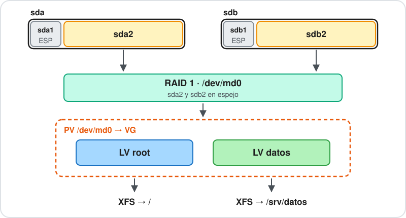

- RAID, pegado a los discos: tolerancia a fallas.
- LVM, sobre el RAID: flexibilidad para repartir y ampliar.

> **Nota docente:** es el esquema clásico de un servidor con dos discos y lo que arman los instaladores al elegir RAID y LVM. La ESP queda fuera del RAID porque el firmware UEFI no lo entiende.

---

<a id="cual_conviene"></a>

### ¿Cuál conviene?

- **Servidor con Debian o Rocky:** RAID por software, con LVM si hace falta, y ext4 o XFS encima.
- **Proxmox o un NAS:** ZFS.
- **Escritorio con Fedora u openSUSE:** Btrfs.

---

<a id="seguridad"></a>

## Seguridad


---

<a id="disponibilidad"></a>

### Disponibilidad

Tres propiedades: **confidencialidad**, **integridad** y **disponibilidad**.

- RAID: la falla de un disco no tira el servicio.
- LVM: se amplía sin cortar.
- Btrfs y ZFS: suman integridad con las sumas de verificación.
- El respaldo: protege los datos si todo lo demás falla.

> **Nota docente:** con usuarios y permisos trabajamos sobre todo la confidencialidad. Esta clase es de disponibilidad.

---

<a id="cifrado_del_disco_luks"></a>

### Cifrado del disco: LUKS

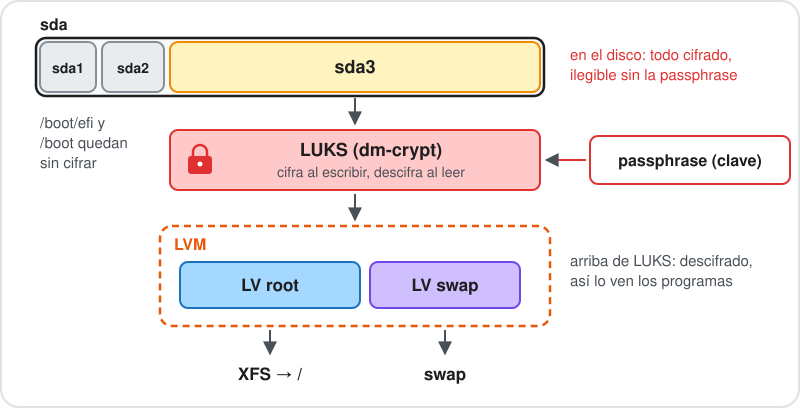

- LUKS cifra todo lo que se escribe en el disco. Para abrirlo hace falta la *passphrase* (la clave).
- Un disco robado o tirado sin borrar no se puede leer.
- Es la opción «LVM cifrado» del instalador que vimos en la [clase 3](../clase3.html#/etapas_instalador).
- Lo común es usarlo en notebooks y escritorios. En un servidor la *passphrase* es un problema: tiene que poder arrancar solo. Cuando se cifra un servidor, se usa un desbloqueo automático.

> **Nota docente:** protege solo con el equipo apagado; encendido, lo que cuida los datos son los permisos. En servidores se cifra cuando lo exige una norma (datos de pago o de salud) o cuando el equipo está en un lugar que no controlamos. El desbloqueo automático se hace con el chip TPM del equipo, con un servidor de claves en la red (Clevis y Tang en Rocky) o escribiendo la *passphrase* por SSH al arrancar. Fuera del curso. Si se pierde la *passphrase*, se pierden los datos. BitLocker y FileVault hacen lo mismo en Windows y macOS. Sin práctica.

---

<a id="resumen"></a>

### Resumen

- **LVM:** PV, VG y LV. Junta discos y reparte volúmenes que crecen en caliente con `lvextend -r`.
- **Thin:** se ocupa al escribir. Hay que vigilar el pool.
- **Instantáneas:** para probar cambios y respaldar. No son respaldos.
- **RAID 0, 1, 5, 6 y 10:** distribución, espejo, paridad simple, doble paridad y espejos repartidos.
- **RAID en Linux:** por software y eficiente; ZFS y Btrfs lo integran al sistema de archivos.
- RAID no es un respaldo.

---

<a id="labs"></a>

## Actividades prácticas y laboratorios


---

<a id="labs_clase"></a>

### Actividad práctica — Laboratorios 12.1 y 12.2

**Objetivo:** ampliar la raíz de la VM Rocky con LVM y volver atrás un cambio con una instantánea.

- 12.1: agregar un disco de 4 GB, sumarlo al VG `rl` y ampliar `/` en caliente.
- 12.2: tomar una instantánea de un volumen, romper sus datos y restaurarlos.

[Laboratorio 12.1 — Ampliar la raíz con LVM](https://github.com/kity-linuxero/linux410-labs/blob/main/lab12/lab12.1.md)

[Laboratorio 12.2 — Instantánea de LVM](https://github.com/kity-linuxero/linux410-labs/blob/main/lab12/lab12.2.md)

> **Nota docente:** los dos están escritos y probados en la VM (12.1 el 2026-10-13, 12.2 el 2026-10-14). Para montar la instantánea con XFS hace falta `-o ro,nouuid`. RAID no se practica (decisión del 2026-10-13). La VM Rocky se descarga de linux-files.idep.atepba.org.ar para quien no hizo el Lab 10.2. El disco se agrega con la VM apagada. La instantánea de VirtualBox se toma con la VM apagada al empezar el 12.1 y se restaura al terminar el 12.2.

---

<a id="referencias"></a>

### Referencias

- Ayuda local: `man lvm`, `man lvmthin`, `man lvextend`, `man lvconvert`, `man mdadm`, `man md`.
- [Red Hat: configurar y administrar volúmenes lógicos (RHEL 9)](https://docs.redhat.com/en/documentation/red_hat_enterprise_linux/9/html/configuring_and_managing_logical_volumes/index).
- [MD del kernel Linux](https://docs.kernel.org/admin-guide/md.html).
- [RAID Calculator](https://www.raid-calculator.com): capacidad, ganancia de velocidad y fallas que tolera cada nivel.
- [Estado de los perfiles de Btrfs](https://btrfs.readthedocs.io/en/latest/Status.html).
- [Conceptos de OpenZFS](https://openzfs.github.io/openzfs-docs/man/master/7/zpoolconcepts.7.html).
- [LVM thin en Proxmox](https://pve.proxmox.com/wiki/Storage:_LVM_Thin).
